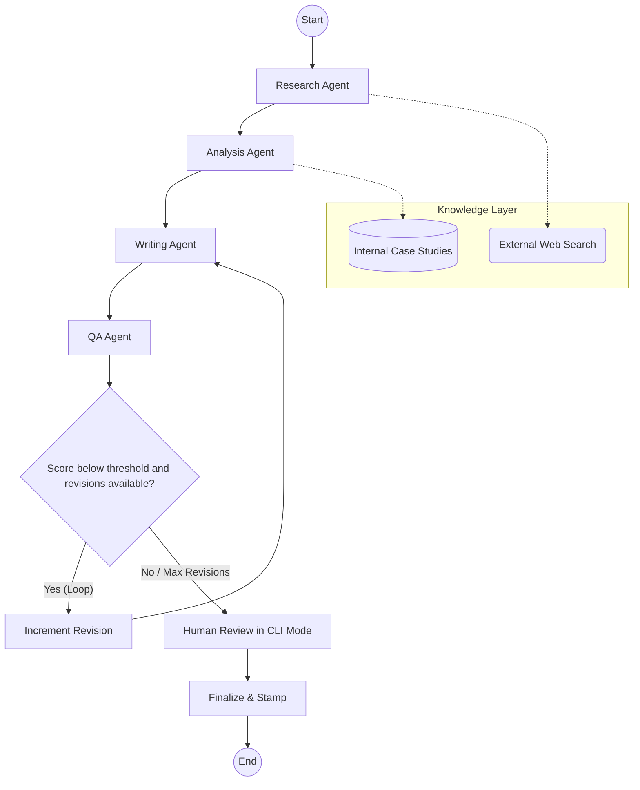

# 🚀 B2B Proposal Generator

An enterprise-grade multi-agent AI system designed to automate the end-to-end creation of high-impact B2B proposals. By combining specialized AI agents with RAG (Retrieval-Augmented Generation), this system delivers data-driven, client-ready proposals in minutes.

---

## 🎯 What We Are Solving
In the B2B world, crafting a winning proposal is often a manual, high-friction process that takes days:
- **Information Overload**: Sales teams spend hours digging through case studies and websites.
- **Inconsistency**: Manual drafting leads to varied quality and missed brand standards.
- **Slow Turnaround**: Review loops between research, writing, and QA create bottlenecks that lose deals.

---

## 💡 What This Project Is
The **B2B Proposal Generator** is a "Sales Engineer in a Box." It uses a directed graph of AI agents to:
1.  **Research** your prospect instantly using real-time web search.
2.  **Analyze** internal case studies to find the perfect value match.
3.  **Draft** a complete, hyper-personalized proposal.
4.  **Audit** the output through a rigorous QA loop before you even see it.

---

## 🛠️ Our Approach: The Multi-Agent Pipeline
We don't just "ask a chatbot" to write a proposal. We use **LangGraph** to orchestrate a specialized team:

- **Collaborative Intelligence**: Four distinct agents (Research, Analysis, Writer, and QA) handle specific parts of the workflow.
- **Memory & Persistence**: LangGraph stores checkpoints in SQLite. Completed web proposals remain available after an API restart.
- **Fact-Grounded RAG**: Integrated with **ChromaDB** for internal knowledge and **Tavily** for external market data.
- **Human-in-the-Loop**: The interactive CLI supports a human approval step. The web app finalizes proposals automatically.

### 🔄 System Architecture


---

## 🚀 Getting Started

### 1. Backend

From the repository root, create the environment and install the dependencies.

```bash
python3.11 -m venv .venv
source .venv/bin/activate
python -m pip install -r requirements.txt
```

If you don't have a `.env` yet, copy `.env.example` to `.env`. Set `GROQ_API_KEY` or `OPENROUTER_API_KEY` for the model, and set `TAVILY_API_KEY` for research. Use a model ID supported by your provider.

```bash
python scripts/ingest_data.py
python scripts/run_api.py
```

Run ingestion during initial setup or after updating the files in `data/`. The API listens at [http://127.0.0.1:8000](http://127.0.0.1:8000/docs). Run one API worker so the live job status stays available throughout each generation.

For PDF export on macOS, install Pango and expose its libraries before launching the API. [WeasyPrint installation guide](https://doc.courtbouillon.org/weasyprint/latest/first_steps.html)

```bash
brew install pango
export DYLD_FALLBACK_LIBRARY_PATH="$(brew --prefix)/lib${DYLD_FALLBACK_LIBRARY_PATH:+:$DYLD_FALLBACK_LIBRARY_PATH}"
```

### 2. Frontend

In a second terminal, from the repository root:

```bash
cd frontend
npm ci
npm run dev
```

Open the [proposal generator](http://localhost:3000). Next.js proxies browser API requests to `127.0.0.1:8000` by default. Set `BACKEND_URL` before starting Next.js if FastAPI runs at a different address.

To use human review, run `python scripts/cli_demo.py` from the repository root and select the Human Review mode.

---

## 🔮 Future Roadmap

- **🎨 Multi-Format Export (PPTX/DOCX)**: Go beyond PDF and Markdown. Generate full-blown sales decks and Word documents ready for final formatting.
- **✍️ Section-Level Re-writes**: Don't like one paragraph? Highlight it and ask the agent to rewrite just that section using a different "tone" or data point.

---
*Built with ❤️ for High-Performance Sales Teams.*
